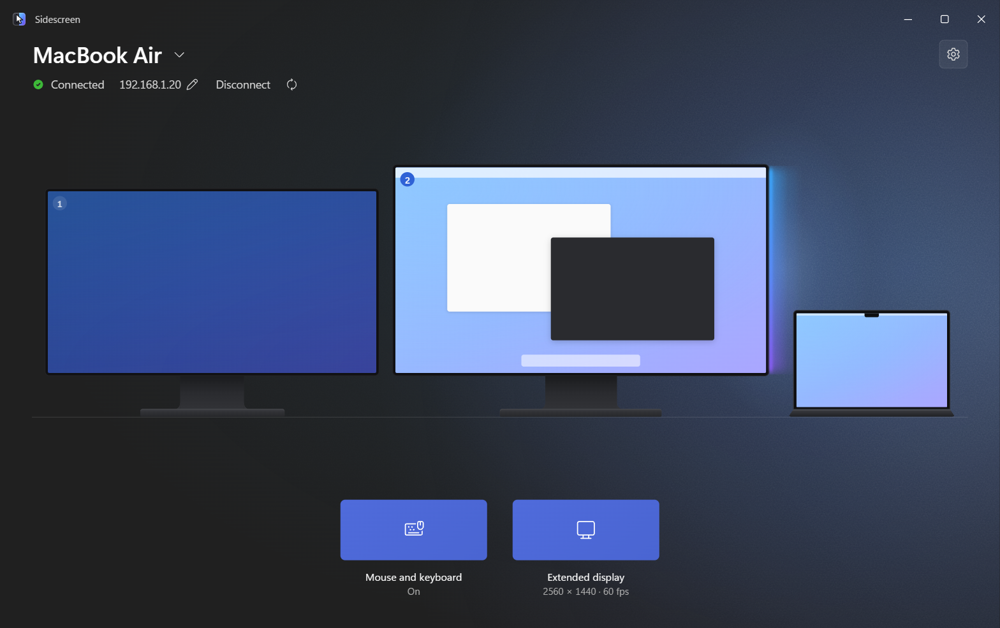
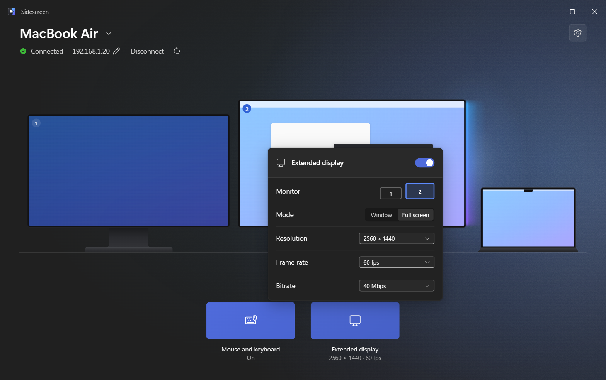
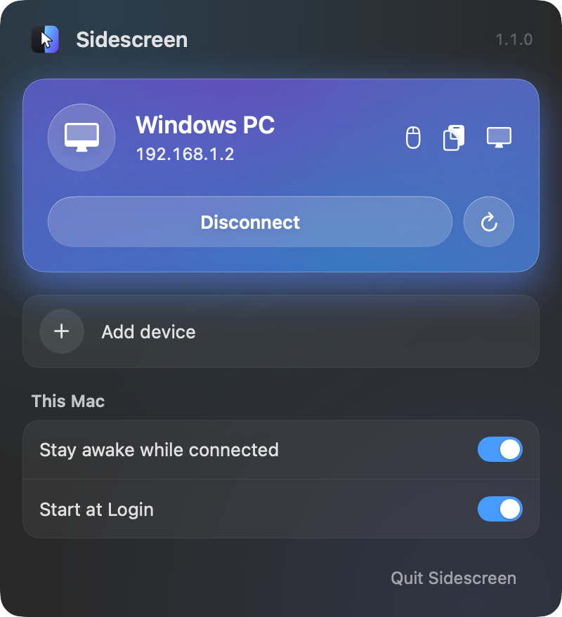

<div align="center">


# Sidescreen

**One desk. Your laptop and your main displays, working as one.**




</div>

Sidescreen unites the computers on your desk. Your laptop gets an extra display on your big screens, and one keyboard, one mouse and one clipboard work across everything. No switching inputs, no capture card, no second keyboard, over Wi-Fi or a cable.

## What you get

- **An extended display** for your laptop, shown on any of your monitors, in a window or full screen.
- **One mouse and keyboard.** Move past the edge of your screens onto the laptop and back, the way the devices really sit on your desk. Your usual shortcuts work there too.
- **One clipboard** for text, images and files.
- **Your keyboard language** follows you from one device to the other.
- **Each part on its own.** Turn the mouse and keyboard off for a game and keep the display, or the other way round.
- **Simple and private.** Pair once with a 6-digit code. After that it's one click, and everything between your devices is encrypted.

Today Sidescreen links a Windows PC with a Mac.

<div align="center">
&nbsp;&nbsp;
</div>

## Get started

1. **Install it on both devices** from the [latest release](../../releases/latest).
   - **Windows:** run the installer. It also sets up [Moonlight](https://moonlight-stream.org) for the display.
   - **Mac:** drag Sidescreen into Applications and open it. A short guide asks for two permissions and installs [Sunshine](https://app.lizardbyte.dev/Sunshine). The first time, macOS may ask you to allow it under Privacy & Security.
2. **Pair them once.**
   - On the Mac, open Sidescreen in the menu bar and choose **Add device** to get a code.
   - On the PC, choose **Find devices** and type the code.
3. **Arrange your desk.** Drag the laptop in the picture to where it really sits, then turn on what you want.

On the Mac, Ctrl works as ⌘ and Alt as ⌥ Option, and the wheel scrolls the Mac's way (both can be turned off under Mouse and keyboard). Take the mouse and keyboard back at any time with Ctrl+Shift+Alt+Win.

## Build from source

You need Rust and Node.js, and on the Mac Xcode's command line tools.

```powershell
cd app; npm install; cd ..
./scripts/build-windows.ps1      # Windows installer
```

```bash
cd app && npm install && cd ..
bash scripts/make-dmg.sh         # Mac app and DMG
```

Tests: `cargo test --workspace`, and `npm test` in `app/`.

## How it works

The apps are [Tauri](https://tauri.app) and Rust on both sides, with [Fluent UI](https://react.fluentui.dev) on Windows and SwiftUI on the Mac.
- **The display:** a virtual display, streamed with [Sunshine](https://github.com/LizardByte/Sunshine) and [Moonlight](https://github.com/moonlight-stream/moonlight-qt).
- **Input:** capture and replay come from [Lan Mouse](https://github.com/feschber/lan-mouse).

## License

Free software under the [GNU General Public License v3.0](LICENSE). See [THIRD-PARTY-NOTICES.md](THIRD-PARTY-NOTICES.md) for the projects it builds on.
