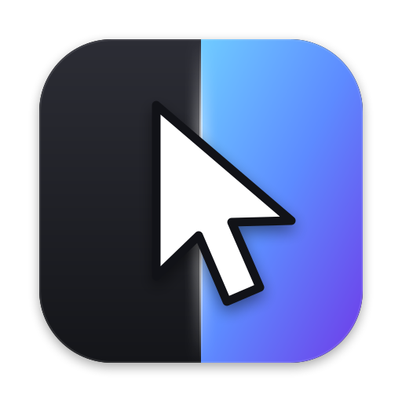
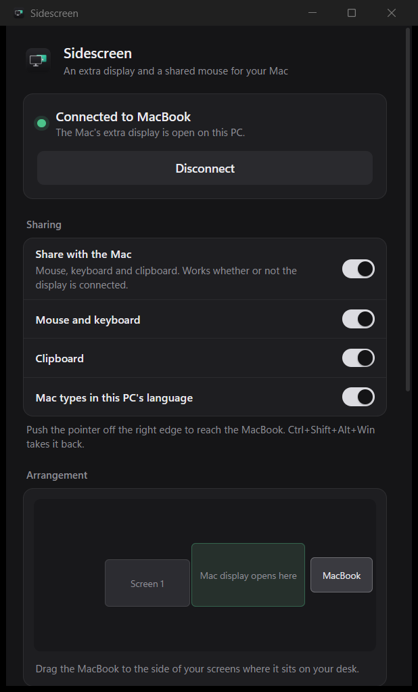
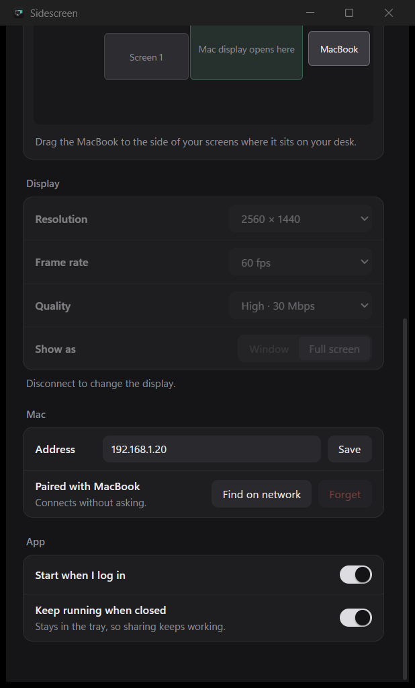
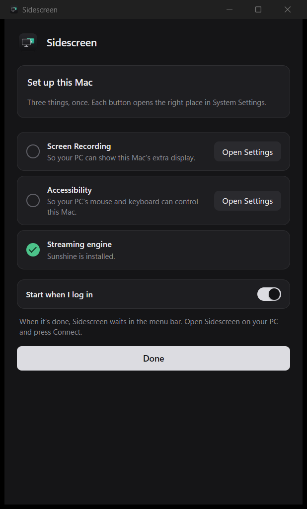

<div align="center">



# Sidescreen

**Your Mac's extra display, in a window on your Windows PC. One mouse, one keyboard, one clipboard for both.**




</div>

## Why

You have a Windows PC with good monitors and a MacBook beside it. Sidescreen makes them one desk:

- The Mac gets **a real extra display** that lives in a window (or full screen) on one of your PC's monitors. Drag Mac windows onto it like onto any external screen.
- Your PC's **mouse and keyboard** move straight onto the MacBook's own screen when you push the pointer past the edge, and come back the same way.
- **Copy on one, paste on the other**: text, images and files.

No cables needed, no capture card, no second keyboard.

## What it does

### An extra display for the Mac

Sidescreen creates a virtual display on the Mac at the resolution you choose and shows it on the PC, sharp and smooth (up to 4K and 120 fps). Point at it and click: the PC's pointer works on the Mac display directly. Alt-Tab stays with Windows.

### One mouse and keyboard

Push the pointer off the edge of your screens towards the MacBook and it continues on the Mac. Come back and it lands exactly where you'd expect, even inside the display window. Drag a window from the MacBook onto the extra display in one move.

### Your language follows you

While you type on the Mac, it uses the same keyboard language as your PC. Alt+Shift or Win+Space switches both at once.

### One clipboard

Copy text, an image or files on either computer and paste them on the other. Files travel in the background without slowing the pointer down.

### Works however they're connected

Same Wi-Fi, a cable between them, or [Tailscale](https://tailscale.com) when you're away from home: Sidescreen learns every address the Mac has and uses whichever answers fastest.

### Private by design

Pairing happens once, with a click on the Mac. Everything between the two computers is authenticated with that pairing, and mouse, keyboard and clipboard traffic is encrypted.

<div align="center">
&nbsp;&nbsp;
</div>

## Install

### On the PC

Download **Sidescreen_1.0.0_x64-setup.exe** from the [latest release](../../releases/latest) and run it. It also installs [Moonlight](https://moonlight-stream.org), which Sidescreen uses to show the Mac's display.

### On the Mac

1. Download **Sidescreen_1.0.0_aarch64.dmg** from the [latest release](../../releases/latest), open it and drag Sidescreen into Applications.
2. Open Sidescreen. The first time, macOS may say it can't check the developer: open **System Settings → Privacy & Security** and click **Open Anyway**.
3. A short setup guide appears. Click each step: **Screen Recording**, **Accessibility**, and **Install** for the streaming engine ([Sunshine](https://app.lizardbyte.dev/Sunshine)). Each one opens the right place or does it for you, and ticks itself off when done.

Sidescreen then lives in the menu bar.

### Pair them

On the PC, open Sidescreen, press **Find on network** (or type the Mac's address), then **Connect**. Click **Allow** on the Mac. That's it: from then on, Connect just works, and both apps start with your computers.

## Using it

| | |
|---|---|
| **Connect / Disconnect** | The big button on the PC, or the tray icon. |
| **Full screen or window** | Under Display. In full screen, a slim bar at the top of the display opens on hover: settings, windowed, move to another monitor, disconnect. |
| **Where the MacBook sits** | Drag the MacBook in the arrangement picture to the side of your screens where it really is. |
| **Pause sharing** | One switch, in the window, the PC tray or the Mac menu, stops mouse, keyboard and clipboard sharing until you turn it back on. |
| **Take the mouse back** | Ctrl+Shift+Alt+Win always returns the mouse and keyboard to the PC. |

## How it works

Sidescreen is a [Tauri](https://tauri.app) app in Rust on both computers.

- **The display**: a small helper creates a virtual display on the Mac (CoreGraphics' virtual display API); [Sunshine](https://github.com/LizardByte/Sunshine) streams it and [Moonlight](https://github.com/moonlight-stream/moonlight-qt) shows it on the PC. Sidescreen starts, pairs, places and stops them for you.
- **Mouse, keyboard and clipboard**: Sidescreen's own encrypted link (ChaCha20-Poly1305, keys from the pairing), using input capture and replay from [Lan Mouse](https://github.com/feschber/lan-mouse) and the clipboard through [arboard](https://github.com/1Password/arboard).

## Build from source

You need Rust, Node.js, and on the Mac Xcode's command line tools.

```powershell
cd app; npm install; cd ..
./scripts/build-windows.ps1             # Windows installer
```

```bash
cd app && npm install && cd ..
bash scripts/make-dmg.sh                # Mac app + DMG (builds the display helper too)
```

Tests: `cargo test --workspace`.

## License

Sidescreen is free software under the [GNU General Public License v3.0](LICENSE). It builds on other open-source projects; see [THIRD-PARTY-NOTICES.md](THIRD-PARTY-NOTICES.md).
