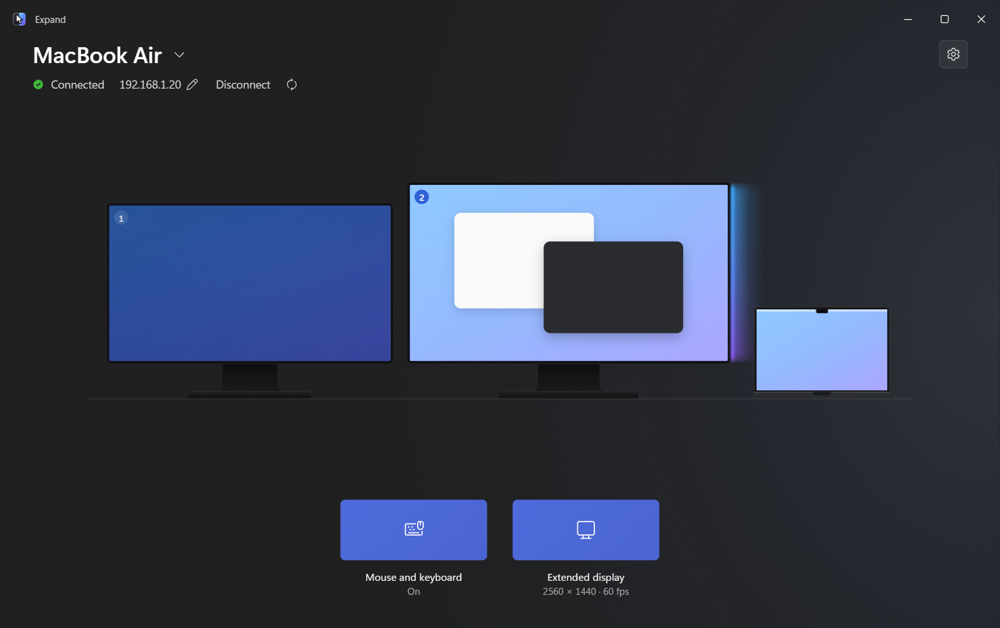
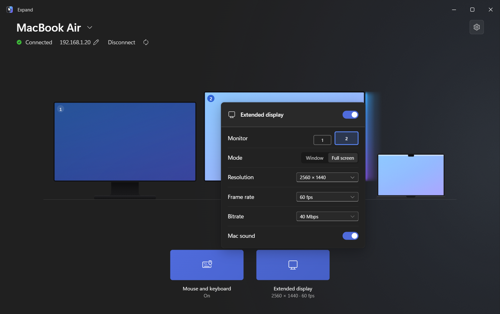
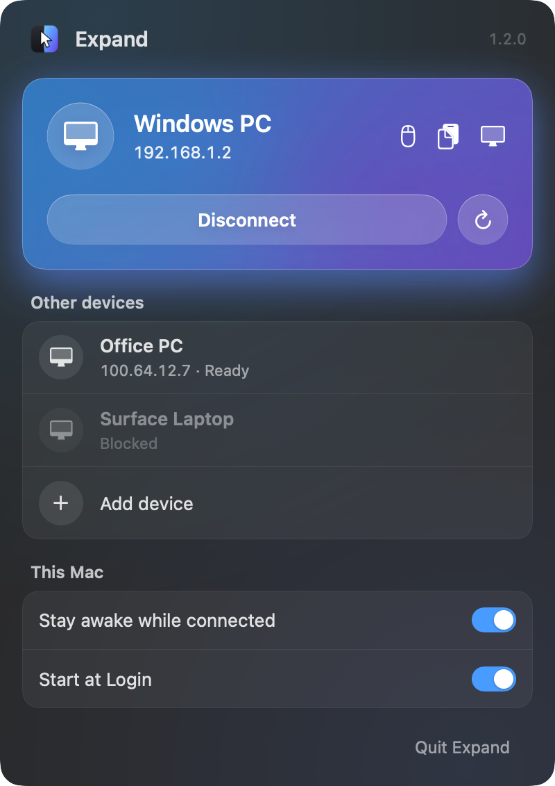

<div align="center">


# Expand

**The one app that joins your laptop and your desktop into one continuous computer.**




</div>

Put your laptop on the desk and join the same network. That's the whole setup. Expand connects by itself, gives the laptop a display on your big monitors, and from then on your mouse, keyboard, clipboard and sound flow between the two as if they were one machine.

No cable, no dock, no capture card, no KVM switch, no second keyboard. And no stack of separate apps for the display, the mouse, the clipboard and the sound: it's all one.

## Everything flows

- **Your laptop on your monitors.** A real extended display for the laptop, on any monitor you choose, in a window or full screen. Its resolution, frame rate and quality are a click away in the bar at the top, without leaving full screen.
- **One mouse and keyboard.** Move past the edge of your screens onto the laptop and back, matched to where it really sits on your desk. Ctrl works as ⌘ and Alt as ⌥ on the Mac, and the wheel scrolls the Mac's way, so your shortcuts just work.
- **Your keyboard language follows you** from one computer to the other.
- **One clipboard** for text, images and files. Copy on one, paste on the other.
- **The laptop's sound on your speakers.** While its display is open, the Mac plays through the PC's speakers or headset.
- **Ready when you are.** Open the lid on your network and it's connected, with the display back where you left it. If the laptop sleeps or drops off Wi-Fi, everything comes back by itself.
- **Each part on its own.** Turn the mouse and keyboard off for a game and keep the display, or the other way round.
- **Simple and private.** Pair once with a 6-digit code. Everything between your computers is encrypted.

## What it replaces

| You used to need | With Expand |
| --- | --- |
| A second-screen app for the laptop | Its display on your monitors, built in |
| A software KVM, or a second mouse and keyboard | One mouse and keyboard across every screen |
| A clipboard sync tool | One clipboard, files included |
| Headphones swapped between computers | The laptop's sound on the PC |
| A dock, a USB-C cable, an HDMI switch | Your network |

## Wireless, on purpose

Expand needs nothing plugged in. Any decent home network carries the display, input and sound with very little delay, so the laptop can sit anywhere on the desk, charging or not. A cable or a faster network only makes it better.

Today Expand links a Windows PC with a Mac laptop.

<div align="center">
&nbsp;&nbsp;
</div>

## Get started

1. **Install it on both devices** from the [latest release](../../releases/latest).
   - **Windows:** run the installer. It also sets up [Moonlight](https://moonlight-stream.org) for the display.
   - **Mac:** drag Expand into Applications and open it. A short guide asks for two permissions and installs [Sunshine](https://app.lizardbyte.dev/Sunshine). The first time, macOS may ask you to allow it under Privacy & Security.
2. **Pair them once.**
   - On the Mac, open Expand in the menu bar and choose **Add device** to get a code.
   - On the PC, choose **Find devices** and type the code.
3. **Arrange your desk.** Drag the laptop in the picture to where it really sits, then turn on what you want.

Ctrl as ⌘ and the Mac's scrolling can be turned off under Mouse and keyboard, and the laptop's sound under Extended display. Take the mouse and keyboard back at any time with Ctrl+Shift+Alt+Win.

## Build from source

You need Rust and Node.js, and on the Mac Xcode's command line tools.

```powershell
cd app; npm install; cd ..
./scripts/build-windows.ps1      # Windows installer
```

```bash
cd app && npm install && cd ..
bash scripts/make-dmg.sh         # Mac app and DMG
```

Tests: `cargo test --workspace`, and `npm test` in `app/`.

## How it works

The apps are [Tauri](https://tauri.app) and Rust on both sides, with [Fluent UI](https://react.fluentui.dev) on Windows and SwiftUI on the Mac.
- **The display:** a virtual display, streamed with [Sunshine](https://github.com/LizardByte/Sunshine) and [Moonlight](https://github.com/moonlight-stream/moonlight-qt).
- **Input:** capture and replay come from [Lan Mouse](https://github.com/feschber/lan-mouse).
- **Sound:** the Mac's system audio travels with the display stream.

## License

Free software under the [GNU General Public License v3.0](LICENSE). See [THIRD-PARTY-NOTICES.md](THIRD-PARTY-NOTICES.md) for the projects it builds on.
